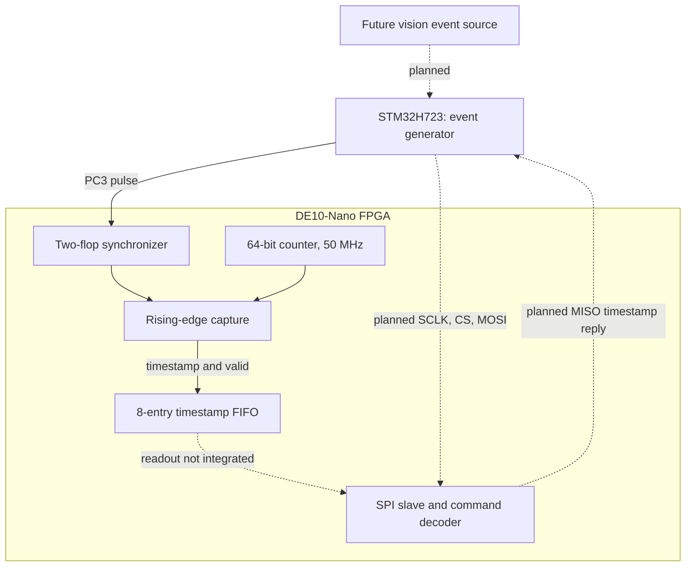

# STM32_Vision — STM32 / FPGA event timestamping

A bare-metal embedded systems project that separates event generation from event timing: an STM32H723 generates GPIO pulses, and a DE10-Nano FPGA synchronizes each rising edge, captures a 64-bit timestamp, and buffers it for retrieval. An SPI command interface is being developed to return those timestamps to the STM32.

The current input is a **synthetic GPIO event**. Camera acquisition, inference, and vision-triggered events are future work. The project currently demonstrates register-level C, custom startup/linker code, interrupt-driven GPIO control, clock-domain crossing, SystemVerilog state machines, and self-checking simulation.

> **Start with the right branch.** The firmware/FPGA work is on [`dev`][dev]. PR [#7 — Feat/spi slave][pr7] merged there, not into `main`. This README describes `dev` at [`c656050`][snapshot], inspected on **2026-10-22**. The `main` code at `3116dd1` contains the earlier STM32 heartbeat milestone. Source links below are pinned to the inspected revision.

## Current evidence and limits

| Area | Evidence at the inspected revision | Status |
| --- | --- | --- |
| STM32 firmware | Built with Arm GNU GCC 13.2.1; `make` and section inspection succeed. Size output: 828 bytes text, 0 data, 0 BSS; one signed/unsigned loop-comparison warning. | **Build reproduced**; this review did not flash hardware. |
| PE1 heartbeat and GPIO bring-up | [PR #1][pr1] reports the timer/LED working; [PR #4][pr4] reports the STM32-to-FPGA GPIO/LED connection working. A [logic-analyzer pulse capture][pulse-image] is committed. | **Historical hardware reports**; no new bench validation. |
| Event synchronization and timestamp capture | `tb_timestamp.sv` passes with Icarus Verilog 12.0: two captures, timestamps 9 and 52, delta 43 FPGA clocks. The committed [waveform][timestamp-image] shows the same subsystem. | **Simulation reproduced**. |
| SPI byte transport | `tb_spi_slave.sv` passes all five cases at a simulated 50 MHz FPGA clock / 1 MHz SPI clock, including receive, partial-byte abort, and preloaded `0xA5` transmit. | **Simulation reproduced**; hardware SPI unverified. |
| Event FIFO | [PR #6][pr6] reports ordering, full/overflow, empty/underflow, wraparound, and simultaneous read/write tests passing before the SPI changes. | **Current regression blocked**: the revised FIFO has compile errors. |
| SPI command/FIFO protocol | A command module and protocol testbench exist in PR #7. | **Incomplete**: protocol compilation fails; no end-to-end timestamp readback is demonstrated. |

Passing the SPI byte test does not establish that command replies, complete timestamp transfers, or FIFO consumption work. Those belong to the currently blocked protocol test.

## System architecture



Solid connections describe the capture modules wired in [`top.sv`][top]; the dotted SPI path is not integrated into that top level. The current FIFO errors also prevent a complete top-level build.

1. **Generate an event.** [`main.c`][main-c] initializes the heartbeat and event GPIO/timer, then repeatedly calls `event_trigger()`. [`event.c`][event-c] raises PC3 and starts TIM3. The TIM3 ISR lowers PC3 and stops the timer. The delay between events is a software loop, so it is not a calibrated event rate.
2. **Cross into the FPGA clock domain.** [`cdc_sync.sv`][cdc] samples the asynchronous input through two flip-flops. [`event_capture.sv`][capture] detects a synchronized rising edge, latches the counter, and asserts `timestamp_valid` for one FPGA clock. A sustained high input produces one capture.
3. **Buffer the timestamp.** [`timestamp_counter.sv`][counter] increments every FPGA clock from reset. The capture feeds an eight-entry, 64-bit [`fifo.sv`][fifo]. The intended current top has `read_en` tied low: after eight accepted events it fills, and further writes are rejected. There is no overflow counter or upstream backpressure.
4. **Retrieve events over SPI — in progress.** The intended STM32 master will send commands and provide clocks; the FPGA slave will return queue status or a timestamp on MISO. The event pulse is a separate signal from SPI, allowing capture timing to be independent of later readout.

At 50 MHz, one timestamp tick represents **20 ns**. This is counter granularity, not measured accuracy relative to the external event: synchronization and edge detection add latency. Minimum pulse width, maximum event rate, and timing accuracy have not been characterized on hardware.

The firmware's `watchdog_*` functions implement a **TIM2 heartbeat**, not an independent hardware watchdog or reset-recovery mechanism. With the assumed 64 MHz timer clock, PE1 toggles once per second. TIM3 uses `PSC=63`, `ARR=1`; that is a nominal two-tick timer interval at 1 MHz, plus software/interrupt overhead—not a guaranteed 1 µs GPIO pulse. See [`timer.c`][timer].

## SPI interface under development

[`spi_slave.sv`][spi-slave] synchronizes SCLK, CS, and MOSI into the FPGA clock domain. Its intended wire format is **SPI mode 0** (`CPOL=0`, `CPHA=0`), **MSB first**, active-low chip select. Receive data is sampled on detected rising SCLK edges; transmit data shifts on falling edges.

The following transactions are the **intended protocol**, as expressed in [`spi_command.sv`][spi-command] and [`tb_spi_protocol.sv`][protocol-test]. They are not yet a validated hardware interface. Hold CS low across the command and all response bytes; ignore MISO during the command byte.

| Command | MOSI transaction | Intended MISO response after the command |
| --- | --- | --- |
| `PING` (`0x00`) | `00 00` | `A5` |
| `STATUS` (`0x01`) | `01 00` | One byte containing FIFO occupancy, 0–8 |
| `READ_EVENT` (`0x10`) | `10` followed by eight `00` dummy bytes | Eight timestamp bytes, most significant byte first (`[63:56]` through `[7:0]`) |

The FIFO change in PR #7 attempts to expose the oldest entry without consuming it. The decoder is intended to snapshot that entry and pop it only after all eight response bytes have been clocked out. Raising CS early should preserve the entry for retry. An empty read is intended to return eight zero bytes without consuming anything; use status to establish whether an event exists.

The passing byte-level bench uses **1 MHz SPI**, with delays around chip-select changes. This is a simulation condition, not a measured maximum bus speed. Command-to-response timing and aborted-read behavior still need verification. MISO currently drives zero when deselected rather than high impedance; shared-bus operation is not established.

## Hardware and source map

The target is an **STM32H723 / NUCLEO-H723ZG** and a **DE10-Nano**. The repository uses CMSIS device definitions with direct register access, rather than STM32 HAL. Hardware evaluation also needs ST-LINK/OpenOCD for the MCU and a Quartus-compatible JTAG setup for the FPGA.

| Signal | Repository evidence | Remaining setup |
| --- | --- | --- |
| Event output | [`gpio.c`][gpio] configures STM32 **PC3**. [PR #2][pr2] calls out Arduino **A2** and FPGA package pin **V12**. | These are historical wiring notes; no checked-in Quartus pin assignments confirm the FPGA mapping. |
| Heartbeat | STM32 **PE1**, toggled from TIM2 ISR. | Observe the heartbeat separately from event readout. |
| FPGA event/clock/reset | `GPIO_EVENT`, `FPGA_CLK1_50`, active-low `rst_n` in `top.sv`. | Board pin assignments and timing constraints must be supplied. |
| SPI | `spi_sclk`, `spi_cs_n`, `spi_mosi`, `spi_miso` exist on the slave module. | STM32 peripheral/pins and FPGA top-level pins are not assigned in the repository. |

Use a common ground between the boards and confirm the board/header mapping and compatible I/O levels before connecting signals. `LED0` is declared but undriven in the current top; the historical LED bring-up does not describe its current behavior.

| Location on `dev` | Purpose |
| --- | --- |
| [`stm32/src/`][stm32-src] | Main loop, event API, heartbeat wrapper |
| [`stm32/drivers/`][drivers] | Register-level GPIO, TIM2/TIM3 configuration and ISRs |
| [`stm32/startup/startup.c`][startup] and [`stm32/linker/stm32h723.ld`][linker] | Vector table, reset handler, `.data`/`.bss` initialization, Flash/RAM placement |
| [`fpga/de10_nano/rtl/`][rtl] | Synchronizer, counter, capture, FIFO, SPI slave/decoder, top level |
| [`fpga/de10_nano/sim/`][sim] | Self-checking SystemVerilog benches and historical generated artifacts |
| `vendor/` | Pinned CMSIS Core and STM32H7 device submodules |

## Build and run the checks

### Get the inspected source

Install Git, GNU Make, the Arm GNU embedded toolchain (`arm-none-eabi-gcc`, `arm-none-eabi-size`, `arm-none-eabi-objdump`), and Icarus Verilog (`iverilog`, `vvp`). GTKWave is optional. OpenOCD and Intel Quartus with Cyclone V support are needed only for the respective hardware workflows.

```sh
git clone --branch dev --recurse-submodules https://github.com/bweiz/STM32_Vision.git
cd STM32_Vision

# Pin the revision documented here; omit this to follow newer dev work.
git switch --detach c656050cbbfa5efb38414c93c6f07df0cd91329c
git submodule update --init --recursive
```

The steps below use the **dev directory layout**, not the older layout on `main`.

### STM32 firmware

From the repository root:

```sh
make
make -C stm32 inspect
arm-none-eabi-size stm32/build/vision_event.elf
```

The root Makefile builds only the STM32 firmware. Outputs are `stm32/build/vision_event.elf` and `stm32/build/vision_event.map`. The build uses Cortex-M7/Thumb, `-Og -g3`, a custom linker script, and no standard startup or standard library. The startup code does not configure a new clock tree; the timers assume the stated 64 MHz clock.

Optional hardware step, **not rerun during this review**, with the Nucleo connected through ST-LINK and compatible OpenOCD scripts installed:

```sh
openocd -f interface/stlink.cfg -f target/stm32h7x.cfg \
  -c "program stm32/build/vision_event.elf verify reset exit"
```

Check PE1 and measure PC3 with a logic analyzer. This firmware has no timestamp display or SPI readback code yet.

### FPGA simulations

The committed `make sim` recipe is broken: a missing continuation makes `rtl/fifo.sv` run as a shell command. Use this explicit command to reproduce the independent timestamp test:

```sh
cd fpga/de10_nano
iverilog -g2012 -s tb_timestamp -o sim/timestamp_sim \
  sim/tb_timestamp.sv rtl/cdc_sync.sv \
  rtl/timestamp_counter.sv rtl/event_capture.sv
vvp sim/timestamp_sim
```

Expected result: `PASS`, timestamps **9** and **52**, delta **43 FPGA clocks / 860 ns**. These are testbench values, not board measurements. Inspect the generated waveform with `gtkwave sim/timestamp.vcd` if desired.

From that same directory:

```sh
make sim-spi
```

Expected result: all five cases pass—ignore clocks while CS is high; receive `0xA6`; receive consecutive bytes; discard a partial byte on CS deassertion; transmit a preloaded `0xA5`. The bench's final banner says `ALL SPI RX TESTS PASSED`, although it also checks that transmit case.

These existing targets are useful regression entry points, but **currently fail during compilation**:

```sh
make sim-fifo
make sim-protocol
```

The FIFO bench covers capture/order, full/overflow, underflow, wraparound, and simultaneous read/write. The protocol bench connects the slave, decoder, and FIFO, injecting test timestamps directly; it is intended to test ping, occupancy, event reads, abort/retry, and empty reads. It does not exercise the STM32 or the event-capture input. Rebuild from source: committed simulator executables and VCD files are historical artifacts, not proof that the current RTL passes.

### Quartus synthesis and programming

The FPGA Makefile provides `compile`, `jtag`, and `program` targets for a project named `vision_event`. **A fresh checkout cannot reproduce the FPGA image yet:** no `.qpf`, `.qsf`, or `.sdc` files are committed, and the constraints directory is empty apart from a placeholder. Repair the RTL and supply the project, device, source list, pin map, and timing constraints first.

After that setup, from the repository root:

```sh
make -C fpga/de10_nano compile
make -C fpga/de10_nano jtag
# Check the detected chain before using the existing program target:
make -C fpga/de10_nano program
```

`program` recompiles and targets `output_files/vision_event.sof` at JTAG chain position `@2`. Confirm that position for the connected hardware. Synthesis, timing closure, and programming were not run in this review.

## Remaining work

- **Repair FIFO/decoder compilation.** `fifo.sv` has a malformed continuous assignment and still assigns `read_data` procedurally after changing it to a wire. `spi_command.sv` has a missing parameter `=`, inconsistent state/command names, a missing `spi_active` port, and `tx_valid`/`tx_load` interface mismatches.
- **Reconcile FIFO test semantics.** The older FIFO bench checks registered data after a pop; the new protocol expects the oldest entry to be visible before a pop. Update and rerun both benches against one explicit contract, including aborted SPI transfers and byte-boundary timing.
- **Connect the return path.** Instantiate the SPI slave/decoder in `top.sv`, connect FIFO reads, expose SPI pins, and implement STM32 SPI master commands. Currently, none of those connections is present.
- **Make hardware builds reproducible.** Commit Quartus project/pin/timing files, fix the timestamp Makefile target, and record the board wiring and tool versions. Add automated simulation checks.
- **Measure the complete system.** Demonstrate STM32 pulse → FPGA timestamp → FIFO → SPI → STM32; record a logic-analyzer trace, returned timestamps, pulse timing, event loss/overflow behavior, and supported rates. No end-to-end performance figures are claimed yet.
- **Add vision events.** Replace or supplement synthetic pulses with a real detection source once capture and readout are validated.

[dev]: https://github.com/bweiz/STM32_Vision/tree/dev
[snapshot]: https://github.com/bweiz/STM32_Vision/tree/c656050cbbfa5efb38414c93c6f07df0cd91329c
[pr1]: https://github.com/bweiz/STM32_Vision/pull/1
[pr2]: https://github.com/bweiz/STM32_Vision/pull/2
[pr4]: https://github.com/bweiz/STM32_Vision/pull/4
[pr6]: https://github.com/bweiz/STM32_Vision/pull/6
[pr7]: https://github.com/bweiz/STM32_Vision/pull/7
[pulse-image]: https://github.com/bweiz/STM32_Vision/blob/c656050cbbfa5efb38414c93c6f07df0cd91329c/docs/pics/event_pulse.png
[timestamp-image]: https://github.com/bweiz/STM32_Vision/blob/c656050cbbfa5efb38414c93c6f07df0cd91329c/docs/pics/async_input_wave.png
[main-c]: https://github.com/bweiz/STM32_Vision/blob/c656050cbbfa5efb38414c93c6f07df0cd91329c/stm32/src/main.c
[event-c]: https://github.com/bweiz/STM32_Vision/blob/c656050cbbfa5efb38414c93c6f07df0cd91329c/stm32/src/event.c
[timer]: https://github.com/bweiz/STM32_Vision/blob/c656050cbbfa5efb38414c93c6f07df0cd91329c/stm32/drivers/timer.c
[gpio]: https://github.com/bweiz/STM32_Vision/blob/c656050cbbfa5efb38414c93c6f07df0cd91329c/stm32/drivers/gpio.c
[top]: https://github.com/bweiz/STM32_Vision/blob/c656050cbbfa5efb38414c93c6f07df0cd91329c/fpga/de10_nano/rtl/top.sv
[cdc]: https://github.com/bweiz/STM32_Vision/blob/c656050cbbfa5efb38414c93c6f07df0cd91329c/fpga/de10_nano/rtl/cdc_sync.sv
[capture]: https://github.com/bweiz/STM32_Vision/blob/c656050cbbfa5efb38414c93c6f07df0cd91329c/fpga/de10_nano/rtl/event_capture.sv
[counter]: https://github.com/bweiz/STM32_Vision/blob/c656050cbbfa5efb38414c93c6f07df0cd91329c/fpga/de10_nano/rtl/timestamp_counter.sv
[fifo]: https://github.com/bweiz/STM32_Vision/blob/c656050cbbfa5efb38414c93c6f07df0cd91329c/fpga/de10_nano/rtl/fifo.sv
[spi-slave]: https://github.com/bweiz/STM32_Vision/blob/c656050cbbfa5efb38414c93c6f07df0cd91329c/fpga/de10_nano/rtl/spi_slave.sv
[spi-command]: https://github.com/bweiz/STM32_Vision/blob/c656050cbbfa5efb38414c93c6f07df0cd91329c/fpga/de10_nano/rtl/spi_command.sv
[protocol-test]: https://github.com/bweiz/STM32_Vision/blob/c656050cbbfa5efb38414c93c6f07df0cd91329c/fpga/de10_nano/sim/tb_spi_protocol.sv
[stm32-src]: https://github.com/bweiz/STM32_Vision/tree/c656050cbbfa5efb38414c93c6f07df0cd91329c/stm32/src
[drivers]: https://github.com/bweiz/STM32_Vision/tree/c656050cbbfa5efb38414c93c6f07df0cd91329c/stm32/drivers
[startup]: https://github.com/bweiz/STM32_Vision/blob/c656050cbbfa5efb38414c93c6f07df0cd91329c/stm32/startup/startup.c
[linker]: https://github.com/bweiz/STM32_Vision/blob/c656050cbbfa5efb38414c93c6f07df0cd91329c/stm32/linker/stm32h723.ld
[rtl]: https://github.com/bweiz/STM32_Vision/tree/c656050cbbfa5efb38414c93c6f07df0cd91329c/fpga/de10_nano/rtl
[sim]: https://github.com/bweiz/STM32_Vision/tree/c656050cbbfa5efb38414c93c6f07df0cd91329c/fpga/de10_nano/sim
